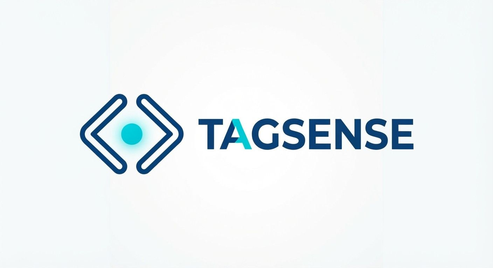

<div align="center">
  
  <h1>TagSense</h1>
  <p><b>Mobile-first tag completion for Acode.</b></p>
</div>

TagSense is a plugin for [Acode](https://acode.app), a code editor for Android. It completes markup as you type on a mobile keyboard. TagSense suggests tag names, inserts matching closing tags, and suggests attributes and attribute values.

This is the initial release. It provides the core completion features for HTML, JSX, SVG, XML, and Vue templates.

## Features

TagSense provides the following features:

* **Tag suggestions:** Suggests valid tag names when you type `<`.
* **Closing-tag insertion:** Inserts the matching closing tag and places the cursor between the tags. TagSense doesn't insert a duplicate closing tag if one already exists.
* **Void tag handling:** Doesn't insert closing tags for void elements such as ``, `<br>`, `<input>`, and `<meta>`.
* **Attribute suggestions:** Suggests global attributes and tag-specific attributes.
* **Value suggestions:** Suggests values for common attributes such as `type`, `rel`, `target`, and `loading`.
* **Case-aware matching:** Preserves letter case in languages that require it, such as XML.

## Supported languages

TagSense includes a profile for each of the following languages:

* HTML
* JSX and TSX
* SVG
* XML and XHTML
* Vue templates

Each profile defines the tags, attributes, and values that TagSense suggests for that language. To add a language, add a profile to the language registry. You don't need to change the core engine.

## Install

Install TagSense from source. You need [Node.js](https://nodejs.org) and npm on your development machine.

1. Clone the repository:

   ```bash
   git clone https://github.com/Sydney205/TagSense.git
   cd TagSense
   ```

2. Install the dependencies:

   ```bash
   npm install
   ```

3. Build the plugin:

   ```bash
   npm run build
   ```

   The build creates a `plugin.zip` file in the project root.

4. Copy `plugin.zip` to your Android device.
5. In Acode, go to **Settings > Plugins > Install Plugin**.
6. Select `plugin.zip`.
7. Enable the plugin.

## Use TagSense

### Get tag suggestions

Type `<`. TagSense shows tag names that are valid for the current language.

### Insert a closing tag

Type a complete opening tag:

```html
<section>
```

TagSense inserts the closing tag and places the cursor between the tags:

```html
<section>|</section>
```

### Type void tags

TagSense doesn't insert a closing tag for void elements:

```html

<br>
<input>
<meta>
```

### Complete attributes and values

After you type a tag name, TagSense suggests attributes for that tag. After you type an attribute name, TagSense suggests values when it has them:

```html
<a href="" target="_blank">

```

## Develop

Run the following scripts from the project root:

| Command             | Description                      |
| ------------------- | -------------------------------- |
| `npm test`          | Runs the automated test suite.   |
| `npm run typecheck` | Checks types.                    |
| `npm run build`     | Builds `plugin.zip`.             |

The test suite covers the following behavior:

* Tag suggestions
* Attribute parsing
* Closing-tag insertion
* Void tag handling
* Language-specific completions

## Planned work

Future releases might include the following improvements:

* Value suggestions for more attributes.
* Framework-specific suggestions.
* Refinements to mobile typing and editor interaction.
* More language profiles and better handling of edge cases in parsing.

## Contribute

To report a bug or request a feature, [open an issue](https://github.com/Sydney205/TagSense/issues). To contribute a change, submit a pull request to the [GitHub repository](https://github.com/Sydney205/TagSense).

## License

TagSense is available under the MIT License. Copyright © Sydney205.